### Merhaba, ben Muhammed 👋

Ankara'da yaşayan bir backend ve platform mühendisiyim. Üç yıldır
production'da çalışan sistemler geliştiriyorum: API tasarımı, veritabanı,
dağıtım ve sunucu işletimi dahil işin tamamıyla ilgileniyorum.

Yazılımın yanında veri merkezi ve sistem/ağ operasyonu geçmişim var;
geliştirdiğim sistemlerin barındırma, ağ, yedekleme ve izleme tarafını da
kendim kurup işletiyorum.

## Şu an

**Pandassist**'te medikal distribütörler için stok, satış, satın alma ve
CRM operasyonlarını yürüten çok kiracılı B2B platformun backend'ini ve
altyapısını geliştiriyorum (Fastify, Next.js, PostgreSQL, Docker).

## Neler yaptım

- **Telemedicine API'si:** doktor, hemşire ve hasta uygulamalarına hizmet
  veren 430+ endpoint'lik backend; ödeme, randevu, uzaktan hasta izleme.
- **Canlı çevirili görüntülü görüşme:** doktor ve hastanın farklı diller
  konuşabildiği platformun FastAPI + LiveKit (WebRTC) backend'ini tek
  başıma tasarlayıp geliştirdim.
- **Klinik işletim platformu:** CRM, randevu, muayene ve faturalama;
  ulusal sağlık altyapısıyla entegre (Django REST Framework).
- **Çok dilli web siteleri:** 7 dile kadar yerelleştirme ve teknik SEO
  içeren altı production sitesi (Next.js).
- **Veri merkezi operasyonu:** 7/24 izleme, fiziksel sunucu kurulumu ve
  ağ yapılandırması.

## Kişisel projeler

| Proje | Ne yapıyor | Teknoloji |
|---|---|---|
| **Yerel yapay zekâ platformu** | Kendi sunucumda yerel LLM'ler, RAG araması ve araç çağıran ajanlar; dışarıya veri göndermeyen, politika ve onay akışıyla sınırlandırılmış altyapı | Ollama, pgvector, Docker |
| **İkinci beyin** | Link ya da metni alıp konuşmayı yazıya, içeriği Türkçe özete çeviren ve anlamsal aramaya açan kişisel bilgi hattı | faster-whisper, yerel LLM |
| **TABAK** | Diyetisyenler için platform; tek kod tabanından web ve mobil, 1.299 otomatik test | FastAPI, PostgreSQL, Expo |
| **Filo takip ve telemetri** | Konum akışından sefer üretimi ve yakıt anomalisi tespiti | TypeScript, TimescaleDB, Redis |
| **DOKUM** | e-Fatura PDF/XML dosyalarını Excel'e çevirir; okunan her değeri belge metnine karşı doğrular | Python |
| **D&D Companion** | Birim testli kural motoru, karakter sihirbazı ve 3D zar | Next.js, Supabase |
| **Programatik video hattı** | Ham çekimlerden otomatik vlog kurgusu | Remotion, ffmpeg |

Depolarımın çoğu gizli; merak ettiğin bir proje olursa yazabilirsin.

## Kullandıklarım

**Diller:** TypeScript/Node.js, Python, C#/.NET, SQL, Bash 
**Backend:** Fastify, FastAPI, Django REST Framework, Express, OpenAPI 
**Veri:** PostgreSQL (RLS, pgvector, TimescaleDB), MongoDB, Redis 
**Altyapı:** Linux, Docker, GitHub Actions, GitLab CI/CD, Nginx 
**Yapay zekâ:** OpenAI API, Ollama, RAG, konuşma-metin 
**Frontend:** React, Next.js, React Native/Expo, Tailwind CSS 
**Test:** pytest, Vitest, Playwright

## İletişim

[LinkedIn](https://www.linkedin.com/in/muhammed-%C3%B6zdemir-891967194)

Bu sayfadaki görseller bu depodaki SVG dosyalarıdır; katkı şehri her gün <a href="./scripts/skyline.py">kendi betiğimle</a> yeniden üretilir.
